   

 

---

## ✦ Sobre mim

Oi, eu sou o **Pedro Paulo**. Estou no segundo ano do ensino técnico e uso o GitHub para guardar e mostrar o que vou construindo ao longo dos estudos.

Gosto de juntar duas coisas: **programar** (C#, banco de dados, web) e **desenhar interfaces** (Figma, Canva, Photoshop). Cada projeto aqui é um passo da minha evolução.

- 🎓 Cursando o **2º ano técnico**
- 💻 Estudando **C#**, **MySQL** e **desenvolvimento web**
- 🎨 Criando layouts no **Figma**, **Canva** e **Photoshop**
- 🌱 Sempre aprendendo algo novo

---

## ✦ Tecnologias

  

---

## ✦ Projetos

<table align="center">
  <tr>
    <td align="center" width="33%">
      <h3>🌙 Morrow</h3>
      
Projeto web publicado no GitHub Pages.

      
    </td>
    <td align="center" width="33%">
      <h3>🍽️ Recria o site restaurante</h3>
      
Recriação de um site de restaurante.

      
    </td>
    <td align="center" width="33%">
      <h3>📐 Site uso do Flex</h3>
      
Estudo prático de layout com Flexbox.

      
    </td>
  </tr>
</table>

---

## ✦ Estatísticas

 

---

## ✦ Contribuições

<picture>
  <source media="(prefers-color-scheme: dark)" srcset="https://raw.githubusercontent.com/7pdro/7pdro/output/github-snake-dark.svg" />
  <source media="(prefers-color-scheme: light)" srcset="https://raw.githubusercontent.com/7pdro/7pdro/output/github-snake.svg" />
  
</picture>

---

## ✦ Vamos conversar

---

✦ feito com código, criatividade e um pouco de café ✦

